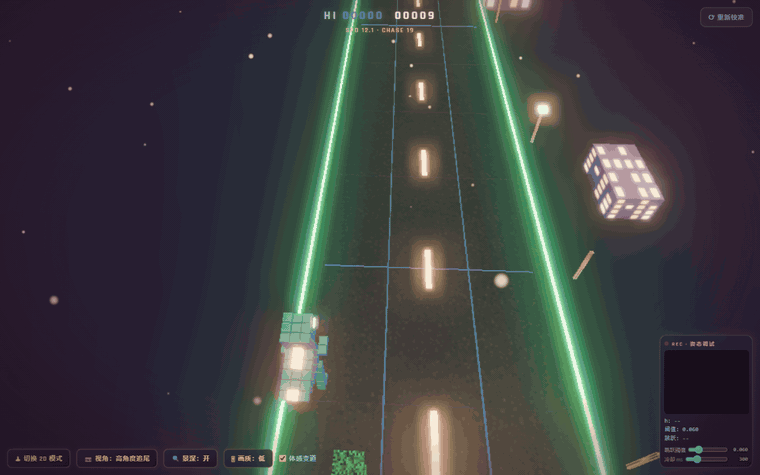

# 体感小恐龙 · DINO MOTION



> 🎮 在线试玩：`https://<你的用户名>.github.io/dino-motion/`（部署步骤见 [docs/DEPLOY-GITHUB-PAGES.md](docs/DEPLOY-GITHUB-PAGES.md)）
> 💻 纯前端 · 零构建 · 零 CDN · 可离线运行

体感 3D 跑酷小恐龙 + Three.js 沉浸式暮色微缩场景。纯前端、无构建步骤。默认 **3D 第三人称追尾跑酷模式（Phase-12：三车道，体感/键盘变道躲避）**，左下角一键切换回 **2D Canvas 兜底模式**（经典 Chrome Dino，保持单车道）。

## 视觉风格（Phase-5：微缩模型 / 高精度体素）

- **暮色光影（Phase-7 调亮）**：天空为深蓝暮色渐变 CanvasTexture（#0a1128 → #1c2b59 → 地平线余晖 #31457c + 程序化星空，同时作为 PMREM 环境反射源）；暖橙 #ffb45e 主平行光 ×3.0（单张 shadow map + PCFSoft）+ 跟随相机补光 + HemisphereLight ×0.95 + AmbientLight ×0.85（背光面不死黑）；ACESFilmicToneMapping（exposure 1.35）+ OutputPass；FogExp2 淡雾（密度 0.0055、雾色=地平线锚色 #1c2b59，远处自然隐入夜空）。零外部贴图文件——柏油路面、星空、天际线窗户等纹理全部由 Canvas 程序化生成。
- **体素恐龙**：约 90 个微小立方体（VOXEL=0.17u）经 4 个 InstancedMesh 拼装（躯干 85 体素 / 暖色自发光背脊 / 发光眼睛 / 双腿各 6 体素），MeshPhysicalMaterial 青绿高反光塑料 + clearcoat 玻璃质感。
- **微缩跑道（Phase-7 提亮 / Phase-8 动效）**：深灰柏油路面（程序化沥青纹理 + roughness 0.62 / envMapIntensity 0.7 微弱反光，无真反射）+ 提亮路缘石 + 中央暖色发光虚线灯（InstancedMesh）；两侧为**无限循环回收池**（Phase-9）：高低错落的微缩建筑（高度方差 0.8~6.4u 幂分布 + 暖黄窗户 emissiveMap 55% 亮窗）、方块树与暖黄发光路灯（灯头 ×3.4）——实例 z 越过相机后即重推到 240u 最前端并重新随机化宽高/颜色/灯头亮度，任何时刻两侧非空、错落不重复（3 个 InstancedMesh，draw call 不变）。
- **跑道动效（Phase-8）**：两侧车道冷蓝**彗星流光带**（UV 随距离滚动，越快流光越急；InstancedMesh 2 实例 = 1 draw call）+ 路缘石顶**霓虹绿 #39ff88 边界发光实线**（Phase-9 加长至 340u 延伸至雾视距尽头、全程无断点；亮度超 Bloom 阈值出光晕，与障碍橙/青明确区分）+ **落地冲击波**（恐龙落点贴地冷青光环放大淡出；3 格 InstancedMesh 对象池循环复用、运行期零 new，复用障碍圆环纹理）——三者均纳入降级链（L1 关流光/冲击波，L2 再关霓虹边线）。
- **三类体素障碍（Phase-13 · Minecraft 风格，取代 Phase-6 双色障碍）**：全部纹理由 16×16 Canvas **程序化像素生成**（NearestFilter 锐利方块感 + generateMipmaps=false，零外部图片/零 CDN 新增）。① **低矮岩浆路障（必须跳）**——暗红硬壳 + 橙黄熔岩裂缝，emissiveMap 与 map 同纹理微弱自发热光；高 `BARRIER_HEIGHT=0.7u` ≈ 恐龙体素身高(12.5×VOXEL=2.125u)/3，贴地占 1 车道（±SPAWN_JITTER 0.2u 抖动）；apex 5.1607 ≥ 2×0.7=1.4 → 跳跃必过，地面撞上 = 失败（沿用 AABB `_crash` 链路）。② **高空黑曜石墙（必须变道）**——冷色深紫黑底 + 紫/青发光斑块 emissiveMap（流光感、厚重『绝对跳不过去』视觉）；高 `WALL_HEIGHT=7.5u` ≥ apex+恐龙身高=7.286 → **跳跃永不翻越**（apex 处恐龙盒顶 5.16+1.9=7.06 < 7.5，碰撞盒 yFit=1.0 覆盖全高）；占 1~2 车道（复用 `pickSpawnLanes`）**恒留 ≥1 条完全畅通安全车道**（红线），A/D 或体感倾斜变道躲避。③ **全宽虚空深坑（必须跳）**——`PIT_WIDTH=9.1u` 不透明虚空板横跨整条跑道，顶面 y=`PIT_TOP_Y`(0.06) 盖住全部路面装饰（虚线 0.0375/车道线 0.04/流光 0.025/刻度 0.015 → 地面纹理视觉完全断开；跑道 mesh 保持连续，性能优先），纹理四边烘焙锯齿暖色发光警示条 + 深处红热裂纹；坑长 ∈ [`PIT_LEN_MIN`=4, `PIT_LEN_MAX`=10]u ≤ min_speed(12)×t_air(1.2143s)×0.687（最慢满跳距 14.57u → 落地余量 ≥4.57u；下限 4u > 恐龙盒深 0.85u → 一步跨不过、『必须跳』成立）；判定 = **平置区间 + Y 反转**：恐龙 z 进入坑区间且 jumpY ≤ `PIT_EPS`(0.1) 贴地 → 坠落失败（下沉+前倾动画），滞空通过 = 安全；**坑后缓冲 `PIT_BUFFER_GAP=30u`**（≥ speed_max 24×0.8s=19.2，取建议带 25~35 中值）杜绝落地即死。生成器 = 纯函数 `pickObstaclePlan(rng, score)` 加权随机（`PLAN_WEIGHTS` Phase-14 起扩展为六类 barrier .32 / wall .25 / pit .18 / slime .10 / snow .08 / coin .07，狂飙期 `PLAN_WEIGHTS_FRENZY` 倾斜；种子采样验收脚本 `tests/sample_obstacle_plan.mjs`：normal 2000 + frenzy 1000 + slowed 1000 排全 0 违规）；三类各自对象池（`BARRIER_POOL`/`WALL_POOL`/`PIT_POOL` = 8/10/5，回收复用零 per-frame 分配；池耗尽 → 跳过生成 = 该排更畅通，绝不制造必死排）；共享 unit box + EdgesGeometry + 每类一个共享纹理材质。撞路障/墙 → **方块碎裂粒子**（48 体素 InstancedMesh 爆散 + 重力 + 地面弹跳）+ 屏幕震动 + 恐龙闪烁；坠坑 → 下沉动画。路障/墙保留贴地发光圆环距离线索（进入 14u 反应距离变霓虹红）；深坑以自身发光警示条为线索（无 blob）。降级链任何档位三类障碍本体全部保留（玩法可见性优先），仅 L1+ 削装饰线框。
- **怪物追逐与狂飙期（Phase-14）**：巨型体素怪物（绿黑苦力怕风 16×16 像素纹理 + 发光红眼，10 个 box 拼装**常驻单例**）在恐龙后方持续追逐——视觉 z/scale 随 `chaseDistance` 线性映射 + 指数平滑（Phase-15《神庙逃亡》式调参：怪物缩小至 0.38~0.55×（原 0.78~1.3）并下沉 M_SINK、位于自恐龙向相机方向偏移 1.3~1.7u 的地面距离上——恒只在屏幕最下缘露头/半身，绝不遮挡恐龙本体与前方障碍；instant -6 等数值跳变在视觉上是快速但平滑地扑近，无瞬移；几何自证 tests/monster_framing.mjs），狂奔上下浮动（L2 降级关）。**chaseDistance 状态机**（`chaseStep` 纯函数，`tests/chase_state_machine.mjs` 24 项断言可种子自测）：初始 `CHASE_INIT`=18u、上限 `CHASE_MAX`=30u；完美通过一排（该排区间无碰撞/减速）+0.5、金币拾取 +0.8（并 +50 分）、自然回复 +0.1/s；撞减速块 instant -6 且减速 2s 内额外 -2/s（怪物猛拉）；**chase ≤ 0 → 怪物扑杀 = 第二死亡路径**（死亡瞬间 0.6s 扑击动画：压向恐龙+跃起+前倾，之后照常弹结算）。**狂飙追逐期**：每 45~60s 随机或 chase<8 立即进入/延长，持续 20s——全场速度 ×1.2、相机 FOV +4.5（平滑过渡 + updateProjectionMatrix，Phase-15 放大幅度降低）、轻微持续震屏、生成权重向减速块/组合路障倾斜、红色危险暗角（Phase-15：强度 = (1−chase/30)^1.5 非线性常驻——怪物逼近的主提示通道；chase<6u 时脉冲呼吸动画、怪物扑杀死亡瞬间屏幕全红；HUD 显示 CHASE 值）。
- **减速块 × 组合路障 × 金币（Phase-14）**：① **粘液块**（绿半透明发光像素纹理，`SLIME_H`=0.75u，占 1~2 车道恒 ≥1 畅通）与 ② **细雪块**（冰蓝发光扁平 `SNOW_H`=0.15u，贴地踩上触发、**跳跃越过不触发**=AABB 薄板语义）——非致命：扣 100 分（总分 clamp ≥0）+ 速度 ×0.55 持续 2s + 红色危险暗角（细雪另加屏幕边缘冰霜覆盖 2s）+ chase 猛拉。③ **组合岩浆路障**：barrier 排扩展为占 1~3 车道（狂飙期 2/3 车道概率升高；3 车道全占 = **必须跳**，apex 红线数学不变），命中任一 = 致命。**反应距离红线**：组合路障(≥2 车道)后接 slime/snow 额外 +`COMBO_FOLLOW_GAP`=8u 落地缓冲；**玩家减速态时禁止生成 pit 排**（0.55×12×1.2143=8.01u < `PIT_LEN_MAX`=10，生成器确定性兜底为单车道 barrier，减速结束恢复）。④ **金币**：单车道 3~5 枚 z 向弧线排布（`COIN_POOL`=12 池化），金色 emissive 自转（L2 关自转不关拾取），AABB 拾取 +50 分 +0.8 chase + 复用冲击波闪光。生成器保持纯函数风格：`pickObstaclePlan(rng, score, {frenzy, slowed})` 六类加权 + `planRowGap(rng, plan, prevPlan, speed)` 间距决策；slime/snow/coin 全池化、怪物常驻单例，update→crash 热路径零 new；16×16 程序化 Canvas 纹理 NearestFilter 延续（零外部图片/零 CDN 新增）。
- **远景**：天空漂浮巨大方块云（Minecraft 式体块、缓慢漂移浮动）；远处微缩体素城市天际线（110 栋 InstancedMesh，暖色窗光 emissiveMap）；跳跃触发粒子场暖金波纹脉冲（uRipple）。
- **移轴景深（关键）**：BokehPass 近远景模糊、中间对焦带清晰 = 桌面微缩玩具感；**左下角「🔍 景深」按钮一键开关**（移动端默认关闭）。淡 Bloom（strength 0.45，threshold 0.7）只让发光体（发光障碍/窗光/车灯虚线/恐龙眼睛）溢出辉光。
- **UI**：Rajdhani 现代科技感无衬线字体（已本地化到 vendor/fonts/，不可达时回退系统无衬线栈）；透明全息玻璃拟态面板（斜向渐变 + blur/saturate + 冷色细描边）+ 暖色微光按钮；标题暖→冷渐变文字。

## 玩法机制

- **3D 跑酷（默认，三车道）**：高角度追尾相机（俯角 52°、注视点前置 5u，Phase-15 前方视野更大；左下角可切换斜 45° 等距视角），恐龙沿 -Z 自动前进、障碍迎面而来；跑道分左/中/右三车道（车道宽 3.0u，微弱蓝色发光分割线 x=±1.5，低于 Bloom 阈值不出光晕），障碍每排由纯函数 `pickObstaclePlan` 加权随机六类（Phase-14：岩浆路障 .32 占 1~3 车道组合**必须跳**（3 车道全占=只能跳） / 黑曜石墙 .25 封 1~2 车道**恒留 ≥1 条畅通、必须变道** / 全宽虚空深坑 .18 **必须跳**、坑后 30u 缓冲禁止立即接墙或路障 / 粘液块 .10 与细雪块 .08 **非致命减速**（-100 分 + 速度×0.55 持续 2s） / 金币 .07 拾取 +50 分 +0.8 追逐距离）；怪物在后方追逐（Phase-15：只在屏幕最下缘露头/半身、绝不挡视线，逼近感由红色脉冲暗角 + 底缘放大传递；相机俯角 52°、注视点前置 5u，前方视野更大），chaseDistance 归零 = 屏幕全红 + 扑杀（第二死亡路径）；狂飙期速度 ×1.2 + FOV +4.5 + 暗角压迫；恐龙在车道间平滑横移（指数阻尼 lerp，非瞬移），AABB 按实际连续 X 判定；三项距离线索辅助判断——障碍物贴地暗色接触阴影光斑随距离缩放、跑道等间距刻度横线（5u）随滚动移动、障碍进入最后反应距离（14u）底边亮暖色；原地起跳驱动 Y 轴抛物线；AABB 碰撞；结算面板（本局分数 + 最高分 localStorage + 再来一局）；分数随距离增加，速度随分数提升但跳跃参数不变。
- **2D 兜底模式**：经典 Chrome Dino 玩法（仙人掌 / 翼龙、加速、分数、碰撞、重开），像素简笔风，核心逻辑原样保留。
- **体感跳跃（Phase-11 重做：完全支持半身/坐姿）**：MediaPipe PoseLandmarker 以**头部 Y 位移**为信号源——两肩中点(11/12)的 Y 为主（对点头/低头更稳），肩部关键点缺失（visibility ≤ 0.5）时回退鼻子(0)；不再依赖髋部，摄像头只拍到上半身也能玩。h = 校准基线 − 当前 headY（归一化坐标，向上为正），基线 = **校准期 2 秒 headY 平均值**，静息时以慢 EMA（α=0.02）补偿久坐下滑漂移。触发需同时满足 **h > 阈值（默认 0.06，滑块可调 0.02~0.20）** 与 **上升速度 v > 0.55/s**（速度门控：坐姿起身/跳跃的头部瞬时速度远高于低头/后靠的慢速漂移）；触发后进入冷却（默认 300ms，滑块可调 150~800），**重武装** = 冷却耗尽 且（已回基线 |h|<0.02 或超过 3×冷却的安全超时），杜绝连击误判（旧『跳跃×21』场景修复）。两种模式共用同一检测链路。
- **变道输入（Phase-12，两通道汇聚 runner.setTargetLane(±1)）**：① **体感变道（默认启用，左下角「体感变道」勾选框可关）**——以校准窗 2 秒采集的**肩中点 X**（landmarks 11/12 均值）为基线，实时偏移 dx 超死区（LANE_X_ENTER=0.05，归一化图像宽 5%）触发左/右变道；滞回带（回到 |dx|<0.025 才重武装）+ 冷却 350ms 双重防抖，杜绝连续倾斜横跳；肩部关键点缺失（visibility≤0.5）不触发不误触发；armed 期基线慢 EMA 防久坐漂移。② **键盘 A/D 或 ←/→**（不受勾选框影响）。边界车道钳制不可越界；仅 3D 模式生效，2D 兜底保持单车道。
- **三通道跳跃**：空格键 / 点击（触摸）/ 原地起跳（体感），全部汇聚到当前模式的同一 jump() 入口（3D：runner3d.jump，2D：dinoGame.jump）。变道同理双通道汇聚同一 setTargetLane() 入口（体感肩中点 X + 键盘）。
- **相机视差**：开场与 2D 模式下鼠标 + 姿态关键点驱动相机轻微偏移；跳跃时相机轻微上抬再弹回（阻尼弹簧）。3D 层与全部覆盖层 pointer-events: none，绝不拦截游戏输入。
- **性能画质档（Phase-10 双向可恢复）**：perf.js 采样 FPS——开局 6 秒预热豁免（shader 编译期卡顿不触发降级）；低于 24fps 持续 5 秒降一级，高于 42fps 持续 4 秒**升回一级**（可一路回到 L0，无单向锁）。**L1** = 景深关 + 粒子×0.5 + 方块云×0.5 + 路侧树隐藏/灯头减半（基于基线 24 重算）+ 障碍线框/流光带/冲击波关；**L2** = 粒子×0.25 + 云/天际线关 + 后处理分辨率×0.65 + 跟随光 1.0/环境光 0.7——**Bloom 辉光、霓虹边线、路侧建筑/路灯全部保留**（签名视觉不剥离）；**L3**（保底）= 在 L2 基础上 Bloom 关 + 跟随光关 + 环境光 0.45 + 路侧景物/霓虹边线关。跑道障碍与恐龙本体任何级别绝不削减。左下角 HUD「🎚 画质」按钮手动循环 **低(默认)→自动→高→低**：**Phase-11 起默认档为『低』**——启动即锁定 L2 并暂停自动采样（Bloom/霓虹边线/路侧景物在 L2 全部保留，低配机也稳）；高 = 暂停采样并锁定 L0 完整画质；自动 = 恢复 FPS 采样（双向升降级）。scene3d.applyQuality(level) 与 runner3d.degradeScenery(level) 均为幂等全量重算，可任意方向调用。移动端自动降低粒子/云/天际线/路侧密度、关阴影、景深默认关。单一 requestAnimationFrame 循环驱动全部渲染，detectForVideo 每帧最多一次。
- **开场流程**（js/introFlow.js 状态机：loading → prompt → calibrating → calibrated → playing，两种模式共用）：全屏加载动画（粒子向中心聚合、方块云与天际线由远及近淡入、暖色进度环环绕标题「DINO JUMP」，进度为 three / runner3d / dinoGame / 体感 bundle / WASM / 姿态模型真实加载状态的聚合，非假计时器）→ 摄像头授权玻璃面板（可「跳过，用空格键玩」）→ 3 秒倒计时校准（中央半透明恐龙剪影作站位参考，第一次成功识别试跳 = 校准成功；校准试跳不会触发游戏跳跃；也可按空格键跳过校准）→ 相机轻推进入游戏。兜底：授权失败或 10 秒未检测到跳跃 → 提示后仍可空格开局；playing 态右上角常驻「⟳ 重新校准」。

## 启动方式

摄像头权限要求 **localhost 或 https** 环境，因此必须通过本地服务器打开（直接双击 file:// 打开无法使用摄像头）：

```bash
cd dino-motion
python -m http.server 8000
```

浏览器打开 <http://localhost:8000> ，允许摄像头权限即可。

## 操作

1. 让摄像头拍到上半身即可：**坐直或站直，上半身处于画面中央**（无需全身入镜；肩部不可见时自动回退鼻子作为头部信号）。
2. 跟随开场流程完成校准（或按空格键跳过校准）。
3. 3D 模式：原地向上跳 → 恐龙起跳越过障碍；空格 / 点击画面同样可跳；**身体左右倾斜（肩中点横移）或按 A/D、←/→ 变道**避开被封的车道；撞击后按空格或点「再来一局」重开。
4. 左下角模式条：**「🕹 切换 2D 模式」/「📷 视角」（追尾 ↔ 等距）/「🔍 景深」（BokehPass 开关）/「🎚 画质」/「体感变道」勾选框（默认开启）**。
5. 右下角调试小窗显示摄像头画面、骨架叠加、h/v/阈值/冷却实时读数、校准采样进度，以及「跳跃阈值」「冷却 ms」两个即时生效的调节滑块。

## 可调常量

| 常量 | 文件 | 默认值 | 说明 |
|---|---|---|---|
| `JUMP_H_THRESHOLD` | js/poseController.js | 0.06 | 头部 Y 位移阈值（UI 滑块可调 0.02~0.20，步进 0.005） |
| `JUMP_COOLDOWN_MS` | js/poseController.js | 300 | 触发冷却（UI 滑块可调 150~800，步进 50） |
| `VEL_MIN` / `RETURN_EPS` | js/poseController.js | 0.55 / 0.02 | 上升速度门控（归一化/秒）/ 回基线判定带（重武装 + 漂移补偿条件） |
| `CALIB_WINDOW_MS` | js/poseController.js | 2000 | 校准窗口：2 秒 headY 平均 = 基线 |
| `LANE_X_ENTER` / `LANE_X_EXIT` | js/poseController.js | 0.05 / 0.025 | 体感变道死区 / 滞回重武装带（归一化图像宽占比） |
| `LANE_COOLDOWN_MS` | js/poseController.js | 350 | 变道冷却（ms），与滞回带双重防抖 |
| `LANE_COUNT` / `LANE_WIDTH` / `LANE_LERP_K` | js/runner3d.js | 3 / 3.0 / 10 | 车道数 / 车道宽(u) / 平滑横移指数阻尼系数 |
| `SPAWN_DOUBLE_P` / `SPAWN_JITTER` | js/runner3d.js | 0.45 / 0.2 | 每排双障碍概率（3 车道最多占 2 → 恒 ≥1 可通过）/ 车道内 X 抖动(u) |
| `GRAVITY` / `JUMP_V0` | js/runner3d.js | 28 / 17 | 3D：apex = V0²/(2G) = 289/56 ≈ 5.16u ≥ 2×2.2u = 4.4u |
| `OBSTACLE_MAX_HEIGHT` | js/runner3d.js | 2.2 | 3D 最高障碍物（世界单位） |
| `CAM_PITCH_DEG` / `CAM_DIST` / `CAM_LOOK_AHEAD` | js/runner3d.js | 52 / 13 / 5 | 高角度追尾：俯角(°) / 相机斜距 / 注视点前置量（Phase-15：俯角 50→52、注视点 4→5，前方视野更大） |
| `ISO_PITCH_DEG` / `ISO_YAW_DEG` / `ISO_DIST` | js/runner3d.js | 45 / 30 / 17 | 斜 45° 等距视角：俯角 / 水平斜角 / 斜距 |
| `SHADOW_SCALE_K` / `SHADOW_FADE_DIST` / `SHADOW_OPACITY_MAX` | js/runner3d.js | 1.4 / 55 / 0.55 | 障碍贴地光斑：距离缩放系数 / 归一化距离 / 最近不透明度 |
| `TICK_SPACING` | js/runner3d.js | 5 | 跑道刻度横线间距（u，每 4 条一主刻度） |
| `WARN_DIST` | js/runner3d.js | 14 | 最后反应距离：底边暖色提示阈值（u） |
| `BASE_SPEED` / `SPEED_GAIN` / `SPEED_MAX_BONUS` | js/runner3d.js | 12 / 0.008 / 12 | 速度-分数曲线（不影响跳跃参数） |
| `ROAD_WIDTH` / `ROAD_LEN` / `DASH_SPACING` | js/runner3d.js | 9 / 280 / 6 | 柏油路面宽 / 长 / 中央虚线灯间距（Phase-5 视觉，非玩法数值） |
| `VOXEL` | js/runner3d.js | 0.17 | 体素恐龙立方体边长（旧 SCENERY_PERIOD/COPIES 已被 Phase-9 回收池常量取代，见下） |
| `SKY_TOP` / `SKY_BOTTOM` | js/scene3d.js | #0a1128 / #1c2b59 | 暮色天空渐变（规格1） |
| `DOF_DEFAULT` / `DOF_FOCUS_PLAY` / `DOF_FOCUS_INTRO` | js/scene3d.js | 桌面开/移动关 / 13.5 / 26 | BokehPass 移轴景深默认与对焦距离 |
| `DOF_APERTURE` / `DOF_MAXBLUR` | js/scene3d.js | 0.0016 / 0.0085 | 景深光圈与最大模糊量 |
| `BLOOM_STRENGTH` / `BLOOM_THRESHOLD` | js/scene3d.js | 0.45·0.7 / 0.35·0.75 | 辉光强度与阈值（桌面/移动端；Phase-7 曝光提高后回调强度防过曝） |
| `toneMappingExposure` | js/scene3d.js | 1.35 | Phase-7：ACES 曝光（1.05 → 1.35，暮色渐变/路面可辨） |
| `hemi` / `ambient` / `keyLight` | js/scene3d.js | 0.95 / 0.85 / 3.0 | HemisphereLight / AmbientLight（Phase-7 新增）/ 暖橙主光强度 |
| `FOG_DENSITY` / `FOG_COLOR` | js/scene3d.js | 0.0055 / #1c2b59 | Phase-9：雾色=SKY_BOTTOM 地平线锚色（远景隐入夜空非黑洞）、密度再降一档 |
| `SCENERY_SPAN` / `SCENERY_KILL` | js/runner3d.js | 260 / 20 | Phase-9 景物回收带：世界 z ∈ [-240, 20]，实例越过相机即回收重推最前端 |
| `BUILD_N` / `POLE_N` / `TREE_N` | js/runner3d.js | 40 / 24 / 32 | Phase-9 建筑/灯杆/树槽位数（两侧合计，密度对齐旧静态段） |
| `EDGE_LEN` | js/runner3d.js | 340 | Phase-9 霓虹边线长：覆盖 [20,-320]，端点 96%+ 雾化 → 全程不可见断点 |
| `SKY_MID` / `SKY_HORIZON` | js/scene3d.js | #16234d / #31457c | 天空渐变中段与地平线余晖亮带（+150 颗程序化星星） |
| `FLOW_UV_K` / `FLOW_COLOR` | js/runner3d.js | 0.16 / #bfefff | Phase-8 流光 UV 滚动系数（offset=distance×K）与冷白蓝色 |
| `EDGE_NEON_COLOR` / `EDGE_NEON_INT` | js/runner3d.js | #39ff88 / 2.4 | Phase-8 跑道边界霓虹绿实线（亮度≈1.76 > Bloom 阈值 0.7） |
| `SHOCK_COUNT` / `SHOCK_LIFE` / `SHOCK_R0→R1` / `SHOCK_COLOR` | js/runner3d.js | 3 / 0.55s / 0.9→3.4u / #7fe9ff | Phase-8 落地冲击波池容量 / 时长 / 半径动画 / 颜色 |
| `ROAD_ROUGHNESS` | js/runner3d.js | 0.62 | Phase-8 柏油粗糙度（0.78→0.62 微弱反光，禁真反射） |
| `BARRIER_HEIGHT` / `WALL_HEIGHT` | js/runner3d.js | 0.7 / 7.5 | Phase-13 路障高（≈恐龙身高 2.125/3；apex 5.16 ≥ 2×0.7 必须跳）/ 墙高（≥ apex+恐龙身高 7.286，跳跃永不翻越） |
| `PIT_LEN_MIN→MAX` / `PIT_EPS` / `PIT_BUFFER_GAP` | js/runner3d.js | 4→10u / 0.1u / 30u | Phase-13 坑长区间（≤ min_speed 12×t_air 1.2143×0.687，落地余量 ≥4.57u）/ 贴地判定 epsilon / 坑后缓冲（≥ speed_max 24×0.8s=19.2） |
| `PLAN_WEIGHTS` / `PLAN_WEIGHTS_FRENZY` | js/runner3d.js | .32/.25/.18/.10/.08/.07 · .40/.16/.10/.16/.13/.05 | Phase-14 六类权重 barrier/wall/pit/slime/snow/coin（狂飙期向减速块/组合倾斜；`pickObstaclePlan` 纯函数 rng 可注入） |
| `BARRIER·WALL·PIT_POOL` / `SLIME·SNOW·COIN_POOL` | js/runner3d.js | 8/10/5 · 8/8/12 | Phase-13/14 对象池容量（耗尽→跳过=更畅通，绝不制造必死排；热路径零 new） |
| `CHASE_INIT→MAX` / `CHASE_REGEN·PERFECT·COIN` | js/runner3d.js | 18→30u · +0.1/s · +0.5 · +0.8 | Phase-14 chaseDistance 初始/上限 / 自然回复 / 完美排 / 金币（另 +50 分） |
| `CHASE_SLOW_INSTANT·DRAIN` / `SLOW_DUR·SLOW_MUL·SLOW_SCORE_PENALTY` | js/runner3d.js | −6 · −2/s · 2s · ×0.55 · −100分 | Phase-14 减速态：进入猛拉 / 减速期额外损 / 时长 / 速度乘子 / 扣分（总分 clamp ≥0） |
| `FRENZY_DUR·CD_MIN·CD_SPAN·TRIGGER` / `FRENZY_SPEED_MUL·FOV_BOOST·SHAKE` | js/runner3d.js | 20s · 45s · 15s · chase<8 · ×1.2 · +4.5 · 0.13 | Phase-14 狂飙期：时长 / 间隔 45+rng×15 / 低距触发 / 速度 / FOV（Phase-15：9→4.5 放大幅度降低） / 震屏 |
| `COMBO_P2·P3`（狂飙）/ `COMBO_FOLLOW_GAP` / `COIN_MIN→MAX` | js/runner3d.js | .30/.15（.40/.30）· 8u · 3→5枚 | Phase-14 组合路障 2/3 车道概率 / 组合后 slime-snow 落地缓冲 / 金币排枚数 |
| MONSTER_Z_NEAR·FAR / M_SCALE_NEAR·FAR | js/runner3d.js | 1.7·1.3u / 0.55·0.38 | Phase-15 怪物视觉地面距离（chase→0 / chase→30，自恐龙向相机方向偏移）/ 缩放（较 Phase-14 的 2.3·1.35/1.3·0.78 大幅拉远缩小） |
| M_SINK·M_SINK_ISO / M_ISO_R_MUL·M_ISO_SCALE_MUL | js/runner3d.js | 2.2·4.6 / 1.118·0.6 | Phase-15 下沉深度系数（×scale，屏幕下缘只露头/半身，几何自证 tests/monster_framing.mjs 追尾/iso 全区间不遮恐龙）/ iso 相机距离·缩放倍率 |
| MONSTER_VIS_RATE | js/runner3d.js | 2.0/s（τ=0.5s） | Phase-15 视觉 z/scale 指数平滑——instant -6 数值瞬跳、视觉 ≥10 帧平滑扑近无瞬移（99% 完成≈139 帧，首帧 3.3%） |
| `WALL_SEG_W·WALL_SEG_D` / `PIT_WIDTH` / `PIT_TOP_Y` | js/runner3d.js | 2.7·0.9 / 9.1 / 0.06 | Phase-13 墙段宽·厚（双封时安全车道净空 3.52u）/ 坑宽横跨全路 / 坑顶面高（盖住路面装饰） |
| 三类像素纹理 | js/runner3d.js | 16×16 Canvas | Phase-13 程序化生成（NearestFilter）：路障岩浆裂缝 / 墙黑曜石亮斑 emissiveMap / 坑虚空+锯齿警示条；取代 Phase-6 `OBST_COLOR_A/B` 双色材质 |
| `EDGE_COLOR` | js/runner3d.js | #ffffff | 障碍 EdgesGeometry 亮白轮廓线框 |
| `RING_COLOR_FAR` / `RING_COLOR_NEAR` | js/runner3d.js | #ff8a1e / #ff0055 | 贴地发光圆环：常态暖橙 / 进入 WARN_DIST 霓虹红（合并原底边警告） |
| `rigLight`（跟随光） | js/scene3d.js | 0xdce8ff ×1.5 | 挂在 camera 下的 DirectionalLight，任何视角从斜上方照亮跑道与障碍 |
| `PARTICLE_COUNT` / `CLOUD_CLUSTERS` / `SKYLINE_COUNT` | js/scene3d.js | 4000/1200 · 11/5 · 110/48 | 粒子 / 方块云簇(×7体块) / 天际线栋数（桌面/移动端） |
| `GRAVITY` / `JUMP_V0` | js/dinoGame.js | 3200 / 800 | 2D：apex = V0²/(2G) = 100px ≥ 2×46px |
| `OBSTACLE_MAX_HEIGHT` | js/dinoGame.js | 46 | 2D 最高障碍物 |

## 目录结构

```
dino-motion/
├── index.html          # importmap + UI 骨架（开场层 / HUD / 结算面板 / 模式条+景深开关 / 暗角）
├── css/style.css       # Rajdhani 全息玻璃拟态 / 暖色微光按钮 / 调试小窗 / 3D HUD 样式
├── js/
│   ├── main.js         # 引导 + 单 rAF 循环 + 三通道输入接线 + 2D/3D 模式切换 + 景深开关接线
│   ├── introFlow.js    # 开场流程状态机（loading→prompt→calibrating→playing，两模式共用）
│   ├── runner3d.js     # 3D 跑酷：体素恐龙(InstancedMesh)/柏油跑道/三车道+分割发光线/流光带/霓虹边线/落地冲击波池/微缩街景/发光障碍/碎裂粒子/AABB 碰撞(连续X)/追尾相机/结算
│   ├── dinoGame.js     # 2D 跑酷兜底（物理常量与跳跃入口，核心未动）
│   ├── poseController.js # PoseLandmarker 头部Y跳跃检测 + 肩中点X体感变道（死区/滞回/冷却）
│   ├── scene3d.js      # Three.js 暮色天空/方块云/天际线/粒子场/BokehPass 景深/Bloom/视差/波纹/画质档 applyQuality（Phase-10 幂等可恢复）
│   └── perf.js         # FPS 双向监测：低帧降级 / 高帧恢复 / 开局预热豁免（Phase-10）
├── tests/              # 种子自验脚本（直接 eval 生产代码纯函数区）：sample_obstacle_plan（4000 排 0 违规）/ chase_state_machine（状态机 24 项断言）
└── README.md
```

## 依赖（已本地化到 vendor/，离线可用）

所有第三方依赖已下载到本地 `vendor/`，页面**不再请求任何 CDN**，可完全离线运行。首次部署请在有网环境运行 `下载本地依赖.bat`（或 `download-vendor.ps1`）拉取一次：

- `vendor/three/`：three@0.160.0（`three.module.js` + `jsm/` 全套 addons；importmap 指向此处，addons 用到 EffectComposer / RenderPass / UnrealBloomPass / **BokehPass** / **OutputPass**）

> ⚠️ **importmap 的地址必须写成相对 URL（`./vendor/...`）或带前导 `/` 的绝对路径**。若裸写成 `vendor/...`（无 `./` 也无 `/`），Chrome 会把它当作裸模块说明符而忽略，报 `Failed to resolve module specifier "three"`，开场加载卡在 2%。
>
> 📌 **部署到 GitHub Pages 等项目子路径站点时，必须用 `./vendor/...`**：绝对写法 `/vendor/...` 会被解析到域名根（`https://user.github.io/vendor/...`）而不是仓库子目录（`https://user.github.io/仓库名/vendor/...`），导致 404。当前 index.html 已改为 `./vendor/...`，根站与子路径站均可用。
- `vendor/mediapipe/`：@mediapipe/tasks-vision@0.10.14（`vision_bundle.mjs` + `wasm/`，含 simd 与 nosimd 两套）
- `vendor/models/pose_landmarker_lite.task`：MediaPipe 姿态模型
- `vendor/fonts/`：Rajdhani（500/600/700，ttf + `rajdhani.css`）

下载脚本主源用国内 npmmirror、回退 npmjs；模型直连 storage.googleapis.com（若被墙，脚本会提示用浏览器另存为到 `vendor/models/`）。字体不可达时自动回退系统字体栈，不影响功能。
